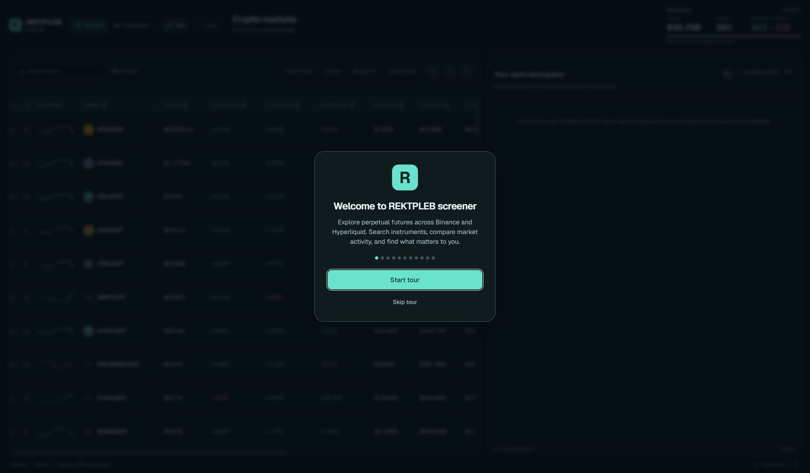
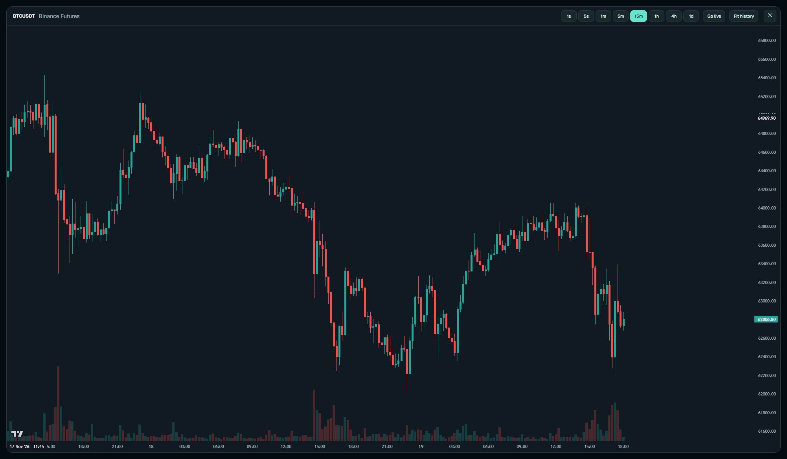

# REKTPLEB screener

**Find crypto perpetuals moving now and check the numbers behind the move.**

Filter Binance and Hyperliquid by price change, volume or open interest. Open a full-screen chart from any row, or hover over an intraday return to see the exact UTC window and prices used. REKTPLEB runs on your computer with public exchange data and keeps your watchlist and settings in your browser.





**No exchange account or API keys required.** Built with React, TypeScript, Node.js and TradingView Lightweight Charts.

## Quick start

Install [Node.js 24 or newer](https://nodejs.org/), download this repository and open a terminal in its folder:

```sh
npm ci
npm start
```

Open **http://127.0.0.1:4173/**. The first start builds the interface automatically. Keep the terminal open; press Ctrl+C to stop.

**Windows:** double-click `start.cmd`. It installs missing project dependencies, builds the interface and opens the browser. Node.js must already be installed. Installation needs internet access; normal use also needs access to the exchanges.

No account, database, Docker, Python or SSH setup is needed for the screener. Python and SSH are required only for the optional connector described below.

## Features

- Live crypto perpetual markets from Binance and Hyperliquid, without tokenized equities, commodity tokens or explicit USDC pairs.
- Sortable metrics, numeric filters, presets, watchlists and CSV export.
- Large rows with sparklines and optional rank highlights. Under Local → Row movement highlights, enable/disable the effect and choose a minimum move of 1–100 places (default: enabled, 2 places).
- Near-fullscreen candlestick charts, defaulting to 15m, with 1s and 5s Binance views.
- Progressive second-based history with 24-hour, 3-day and 7-day requests; older data loads as available within exchange limits.
- Persistent day/night modes and keyboard-accessible dialogs with reduced-motion support.
- Browser notifications for configured conditions while the app is running.
- Automatic market alert charts with 15m context, 1m impulse and 1h trend. Works with public exchange data on first launch.
- An optional read-only TRADING COPILOT connector for the latest saved alert image.

## Data and limits

Intraday price changes compare the open and close of consecutive completed one-minute candles. Hover over a return to see its inputs and formula. A candle captured before it closed is excluded until a fresh exchange response confirms its final value. The 24h column uses the exchange's daily reference.

Ticker data refreshes approximately every 10 seconds. Visible and monitored detail metrics are prioritized around 65 seconds; background scans share a bounded exchange budget. Missing or expired detail fields display `—` instead of invented values. Cached ticker readings carry a stale status when the feed falls behind.

Seconds history comes from real aggregated trades. The first load and backfill can be slow for actively traded instruments. Cached history resumes across restarts; a new installation does not contain preloaded days of data. The status shows coverage and gaps. At most two history symbols are resident at once.

Hyperliquid OI history is observed locally over time; it is unavailable until enough observations exist. OI change in USD means the change in position quantity valued at the current price on both exchanges. Provider restrictions, listing changes and rate limits can affect availability. This app displays data and does not place orders.

## Your data

Settings, watchlists and alerts stay in your browser. Use **Local → Export settings** to back them up. Public market snapshots and chart history are cached in `.cache/`; they are not included in source releases. Stop the app before deleting this folder to clear cached data.

The server listens only on `127.0.0.1`. Requests from foreign websites and unrecognized hostnames are rejected. There is no analytics, hosted account system or credential collection. See [SECURITY.md](SECURITY.md) for boundaries and [the audit](docs/AUDIT.md) for verification and remaining limitations.

## Automatic market alert charts

The right-hand panel scans every supported crypto perpetual pair on the selected exchange, including low-volume pairs and those hidden by table filters. It rotates through small batches while the app is visible. Coverage builds over several minutes and varies with the number of listings, exchange rate limits, and connection speed. The scanner checks recent closed history to catch moves between visits.

An alert requires an absolute 5-minute price move of at least 0.75% and at least 2.5× relative volume. Relative volume compares the current 5-minute quote volume with the average 5-minute volume in the preceding hour. Binance supplies quote volume directly. Hyperliquid volume is estimated from base volume multiplied by each candle's close. Only consecutive closed candles can trigger a signal.

The newest qualifying move replaces the previous chart. After 30 minutes without a new signal, the panel returns to a labelled market overview. The scanner keeps only the current chart and overview for each exchange in memory. It requires internet access and the running local app.

## Optional TRADING COPILOT images

You can replace the built-in alert panel with your own saved screenshots. This connector is **off by default**. It supports an existing TRADING COPILOT installation with `data/copilot.db` and saved PNG files in `screenshots/`.

1. Configure and verify an SSH alias in your own SSH configuration. Prefer a dedicated read-only account limited to the required data. Keep host-key verification enabled.
2. Copy `.env.example` to `.env` and set:

```dotenv
COPILOT_ENABLED=true
COPILOT_SSH_HOST=your-existing-ssh-alias
COPILOT_ROOT=/absolute/path/to/your/copilot
```

3. Restart the app. The remote machine needs Python 3 with SQLite support. The reader only reads files and SQLite; it is sent over SSH and is not installed remotely. No Telegram token is required.

Do not put passwords, private keys, personal SSH configuration or alert images in the repository. The latest image replaces its predecessor; image cache is bounded to 8 MiB and expires after five minutes. Images are matched by symbol and time; ambiguous matches are omitted.

[See how data is verified](docs/AUDIT.md)

## Development

```sh
npm run dev       # local development
npm run verify    # typecheck, regression tests, build, release-source checks
npm audit         # current registry advisories
```

After changing frontend code outside development mode, run `npm run build`. To use a different port, create `.env` with `PORT=4180`. Changing the port changes the browser's storage origin, so import your settings backup if needed.

The CI workflow runs the same checks on Windows and Linux using Node 24. It will run once this repository is pushed to GitHub; local verification is recorded in the audit, without implying an unrun CI result.

## Architecture

The React interface fetches a same-origin Node HTTP API. Exchange adapters implement caching, request deduplication, separate foreground/background lanes and rate budgets. The seconds-history module aggregates trades, repairs detected gaps and stores resumable compressed history. The optional connector is isolated from normal market-data requests.

[Architecture and trade-offs](docs/ARCHITECTURE.md) · [Contributing](CONTRIBUTING.md) · [Release checklist](docs/RELEASING.md)

## License

Project code is MIT. TradingView Lightweight Charts, its attribution, Geist fonts and other dependencies retain their own licenses. See [NOTICE](NOTICE) and [licenses/](licenses/). Market data remains subject to the providers' terms.
